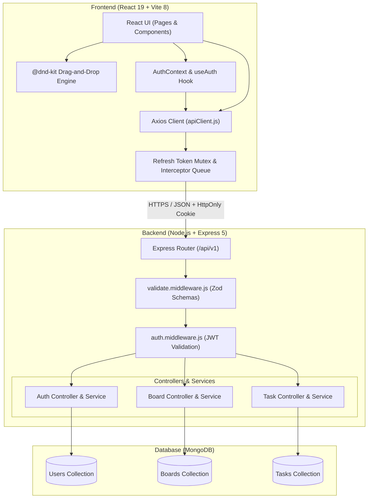

# DevFlow

> **Modern, High-Performance Agile Kanban & Collaborative Task Management Platform**

DevFlow is a full-stack project workflow and task organization platform designed for engineering and product teams. Inspired by the speed of Linear and the spatial flexibility of Trello, DevFlow provides customizable Kanban workspaces, dynamic board columns, jitter-free drag-and-drop task movement, and independent task completion tracking.

---

## Table of Contents

- [Overview](#overview)
- [Key Features](#key-features)
- [System Architecture](#system-architecture)
- [Tech Stack](#tech-stack)
- [Project Directory Structure](#project-directory-structure)
- [How It Works](#how-it-works)
  - [1. Dynamic Column Lifecycle](#1-dynamic-column-lifecycle)
  - [2. Independent Task Completion](#2-independent-task-completion)
  - [3. Jitter-Free Drag-and-Drop Engine](#3-jitter-free-drag-and-drop-engine)
  - [4. Dual-Token JWT Authentication & Session Mutex](#4-dual-token-jwt-authentication--session-mutex)
  - [5. Cross-User Data Isolation](#5-cross-user-data-isolation)
- [API Reference](#api-reference)
- [Getting Started & Local Setup](#getting-started--local-setup)
  - [Prerequisites](#prerequisites)
  - [Installation](#installation)
  - [Environment Configuration](#environment-configuration)
  - [Running Locally](#running-locally)
- [Testing & Quality Assurance](#testing--quality-assurance)
- [Design System & Theme](#design-system--theme)
- [License](#license)

---

## Overview

DevFlow was built to eliminate the rigid constraints of traditional three-column boards. Instead of forcing teams into static `To Do`, `In Progress`, and `Done` silos, DevFlow empowers boards with:

- **Up to 5 dynamic, ordered columns per board** with custom naming, slug generation, and reordering.
- **Independent completion status** allowing tasks in any stage (e.g. *In Review*, *QA*, *Deployment*) to be completed without forcibly shifting them across columns.
- **Predictable, stable drag-and-drop** utilizing midpoint heuristics to prevent visual jitter and infinite React rerenders.
- **Secure session management** using short-lived access tokens with HTTP-only refresh token rotation and client-side request deduplication.

---

## Key Features

- **Workspaces & Boards:**
  - Create, view, update, and delete workspaces with real-time card counts and timestamps.
  - Custom board colors and metadata summaries.
- **Dynamic Kanban Columns:**
  - Add custom columns up to a maximum of 5 per board.
  - Inline column renaming with instant backend synchronization.
  - Column reordering via sequential order indices.
  - Safe column deletion with options to either migrate tasks to another column or purge associated tasks.
- **Task Management:**
  - Create tasks directly from the board header or via inline controls at the bottom of each column.
  - Task priority indicators (`low`, `medium`, `high`) with accessible color coding.
  - Task completion toggle with SVG checkmark animations and independent completion state.
  - Rich task details modal supporting description updates, priority toggles, due dates, and column assignment.
- **Adaptive Kanban Layout:**
  - Responsive column width calibrated to display all 5 columns comfortably on widescreen displays.
  - Content-dependent column height with internal themed scrollbars that prevent page-level vertical overflow.
  - Drag handle and full-card dragging mechanics powered by `@dnd-kit`.
- **Security & Multi-Tenancy:**
  - Dual-token JWT architecture (short-lived access token + secure HTTP-only refresh token).
  - Axios interceptor mutex that queues concurrent requests during token renewal.
  - Strict owner-scoped database queries to guarantee multi-tenant data isolation.

---

## System Architecture



---

## Tech Stack

### Frontend
- **Framework:** React 19 (`react`, `react-dom`)
- **Build Tool:** Vite 8
- **Styling:** Tailwind CSS v4 (`@tailwindcss/vite`) with custom CSS variable design tokens
- **Drag-and-Drop:** `@dnd-kit/core`, `@dnd-kit/sortable`, `@dnd-kit/utilities`
- **Routing:** React Router v7 (`react-router-dom`)
- **HTTP Client:** Axios with dynamic interceptors
- **Icons:** Lucide React (`lucide-react`)
- **Linting:** ESLint 10 with React Hooks plugin

### Backend
- **Runtime:** Node.js (ES Modules, `"type": "module"`)
- **Framework:** Express.js v5
- **Database & ODM:** MongoDB with Mongoose v9
- **Validation:** Zod v4 schemas
- **Authentication:** JSON Web Tokens (`jsonwebtoken`), `bcrypt` password hashing
- **Security & Cookies:** `cookie-parser`, CORS
- **Testing:** Vitest v5, Supertest v7

---

## Project Directory Structure

```text
DevFlow/
├── backend/                         # Node.js + Express backend service
│   ├── public/                      # Temporary storage & static assets
│   ├── src/
│   │   ├── controllers/             # HTTP route controllers
│   │   │   ├── auth.controller.js   # User registration, login, token refresh, logout
│   │   │   ├── board.controller.js  # Workspace & dynamic column management
│   │   │   └── task.controller.js   # Task creation, movement, completion, details
│   │   ├── db/                      # MongoDB connection setup
│   │   ├── middlewares/             # Express middlewares (JWT auth, error handler, Zod)
│   │   ├── models/                  # Mongoose schemas (User, Board, Task)
│   │   ├── routes/                  # Express route definitions (/api/v1/...)
│   │   ├── services/                # Business logic & database operations
│   │   ├── utils/                   # ApiError, ApiResponse, asyncHandler helpers
│   │   ├── validators/              # Zod validation schemas
│   │   ├── app.js                   # Express application setup & middleware assembly
│   │   ├── constants.js             # System constants & cookie options
│   │   └── index.js                 # Server entry point
│   ├── tests/                       # Backend integration & unit tests
│   ├── .env.example                 # Backend environment variable template
│   └── package.json
│
├── frontend/                        # React 19 single-page application
│   ├── public/                      # Static assets (custom favicon.png)
│   ├── src/
│   │   ├── api/                     # Axios API clients & response normalization
│   │   │   ├── apiClient.js         # Base client with 401 token refresh queue
│   │   │   ├── auth.api.js          # Auth endpoints
│   │   │   ├── board.api.js         # Board & dynamic column endpoints
│   │   │   └── task.api.js          # Task manipulation & reordering endpoints
│   │   ├── components/              # Modular presentation & interactive components
│   │   │   ├── auth/                # Logout confirmation modal & auth controls
│   │   │   ├── boards/              # BoardCard, KanbanColumn, Add/DeleteColumn modals
│   │   │   ├── common/              # Button, Input, Modal primitives
│   │   │   ├── layout/              # Navbar, AppLayout with themed scrollbars
│   │   │   └── tasks/               # TaskCard, SortableTaskCard, TaskDetailsModal
│   │   ├── context/                 # AuthContext (state, tokens, session management)
│   │   ├── hooks/                   # Custom hooks (useAuth)
│   │   ├── pages/                   # Top-level view routes
│   │   │   ├── BoardPage.jsx        # Kanban workspace with dynamic drag-and-drop
│   │   │   ├── DashboardPage.jsx    # Workspaces index & creation grid
│   │   │   ├── LoginPage.jsx        # Login authentication view
│   │   │   ├── RegisterPage.jsx     # Registration view
│   │   │   ├── ProfilePage.jsx      # User profile summary view
│   │   │   └── NotFoundPage.jsx     # 404 error view
│   │   ├── routes/                  # AppRoutes, ProtectedRoute, PublicRoute guards
│   │   ├── utils/                   # Drag heuristics, column sorting, task grouping
│   │   ├── index.css                # Tailwind CSS v4 variables & themed scrollbars
│   │   └── main.jsx                 # Frontend entry point
│   ├── index.html                   # HTML template with SEO, Open Graph & theme tags
│   ├── .env.example                 # Frontend environment template
│   └── package.json
│
├── package.json                     # Monorepo root script runner (concurrently)
└── README.md                        # Project documentation
```

---

## How It Works

### 1. Dynamic Column Lifecycle
Each board manages an embedded `columns` array in MongoDB:
```json
[
  { "key": "todo", "name": "To Do", "order": 0 },
  { "key": "in-progress", "name": "In Progress", "order": 1 },
  { "key": "review", "name": "In Review", "order": 2 },
  { "key": "done", "name": "Done", "order": 3 }
]
```
- **Creation:** Adding a column automatically generates a URL-safe unique `key` slug and sets `order = columns.length`. Boards support up to 5 columns.
- **Renaming:** Columns can be renamed inline directly on the board without altering existing task references or column keys.
- **Deletion:** When removing a column, the user specifies an action:
  - `move`: Shifts all tasks in the deleted column to a chosen target column.
  - `delete`: Atomically purges all tasks linked to that column.

### 2. Independent Task Completion
Unlike traditional Kanban implementations that automatically move a task into a `done` column when checked, DevFlow decouples **placement** from **completion**:
- Every task maintains an independent `isCompleted: boolean` flag alongside its `column` key.
- Completing a task triggers a smooth SVG checkmark animation and applies accessible muted styling while preserving its exact order and column location.
- This accommodates real-world workflows where a task may be finished within a specialized stage (e.g. *Code Complete* in *Development*, or *Signed Off* in *QA*).

### 3. Jitter-Free Drag-and-Drop Engine
DevFlow solves common drag-and-drop jitter and re-render loops using a three-tier stability design:
1. **Midpoint Drop Position Heuristic (`calculateTaskDropPosition`):** Calculates insertion order based on the cursor's Y-coordinate relative to the card's vertical center. This prevents cards from jumping when hovering near column boundaries.
2. **Non-Mutating Drag-Over:** During pointer movement (`onDragOver`), task arrays are never mutated in state. This eliminates flickering, reflow layout thrashing, and React's `Maximum update depth exceeded` warnings.
3. **Optimistic Drop Reconciliation (`onDragEnd`):** Final ordering is calculated only upon drop release, updating the UI immediately and synchronizing the reorder array with `PATCH /api/v1/boards/:boardId/tasks/:taskId/move`. If the network request fails, state reverts cleanly to the pre-drag snapshot.

### 4. Dual-Token JWT Authentication & Session Mutex
- **Access Token:** Short-lived JWT stored in memory by `AuthContext`.
- **Refresh Token:** Long-lived JWT stored in an `HttpOnly`, `SameSite: strict` cookie.
- **Transparent Refresh:** When a protected API call returns `401 Unauthorized`:
  1. The Axios response interceptor holds incoming concurrent requests in a promise queue.
  2. A single `POST /api/v1/auth/refresh-token` call is dispatched.
  3. Upon success, the new access token is stored and all queued requests retry automatically.
  4. If the refresh token has expired, the queue is rejected and the user is redirected cleanly to login.

### 5. Cross-User Data Isolation
Every board and task operation strictly scopes queries to the authenticated user's ID:
```javascript
// Example query pattern in TaskService
const task = await Task.findOne({ _id: taskId, owner: userId, board: boardId });
if (!task) throw new ApiError(404, "Task not found or access denied");
```
Users cannot view, mutate, or delete resources belonging to other accounts, even if valid ObjectIds are known.

---

## API Reference

Base URL: `http://localhost:8000/api/v1`

### Authentication Endpoints
| Method | Endpoint | Description | Auth Required |
| :--- | :--- | :--- | :---: |
| `POST` | `/auth/register` | Register a new user account | No |
| `POST` | `/auth/login` | Login user, return access token & set refresh cookie | No |
| `POST` | `/auth/refresh-token` | Rotate refresh token & issue new access token | Cookie |
| `DELETE` | `/auth/logout` | Clear refresh token cookie & invalidate session | Yes |
| `GET` | `/auth/me` | Fetch authenticated user profile | Yes |

### Board & Column Endpoints
| Method | Endpoint | Description | Auth Required |
| :--- | :--- | :--- | :---: |
| `POST` | `/boards` | Create a new board workspace | Yes |
| `GET` | `/boards` | List all boards owned by the authenticated user | Yes |
| `GET` | `/boards/:boardId` | Get board metadata, columns, and task summary | Yes |
| `PATCH` | `/boards/:boardId` | Update board title, description, or color | Yes |
| `DELETE` | `/boards/:boardId` | Delete board and cascade delete its tasks | Yes |
| `POST` | `/boards/:boardId/columns` | Add a new dynamic column (max 5) | Yes |
| `PATCH` | `/boards/:boardId/columns/:columnKey` | Rename an existing column | Yes |
| `PATCH` | `/boards/:boardId/columns/reorder` | Update column display order | Yes |
| `DELETE` | `/boards/:boardId/columns/:columnKey` | Delete column (with `move` or `delete` action) | Yes |

### Task Endpoints
| Method | Endpoint | Description | Auth Required |
| :--- | :--- | :--- | :---: |
| `POST` | `/boards/:boardId/tasks` | Create a task in a specific column | Yes |
| `GET` | `/boards/:boardId/tasks` | Get all tasks belonging to a board | Yes |
| `GET` | `/boards/:boardId/tasks/:taskId` | Get detailed information for a single task | Yes |
| `PATCH` | `/boards/:boardId/tasks/:taskId` | Update title, description, priority, completion | Yes |
| `PATCH` | `/boards/:boardId/tasks/:taskId/move` | Move task to a new column and/or reorder position | Yes |
| `DELETE` | `/boards/:boardId/tasks/:taskId` | Delete a task | Yes |

---

## Getting Started & Local Setup

### Prerequisites
- **Node.js:** v18.0.0 or higher
- **npm:** v9.0.0 or higher
- **MongoDB:** A local MongoDB instance or connection string to MongoDB Atlas

### Installation

1. **Clone the repository:**
   ```bash
   git clone https://github.com/your-username/DevFlow.git
   cd DevFlow
   ```

2. **Install root dependencies:**
   ```bash
   npm install
   ```

3. **Install subproject dependencies:**
   ```bash
   cd backend && npm install
   cd ../frontend && npm install
   cd ..
   ```

### Environment Configuration

#### Backend Configuration
Create `backend/.env` (copy from `backend/.env.example`):
```env
PORT=8000
MONGO_DB_URI=mongodb+srv://<username>:<password>@cluster0.example.mongodb.net/devflow
TEST_DB_NAME=devflow_test
DEV_URL=http://localhost:5173
ACCESS_TOKEN_SECRET=your_super_secret_access_token_key_here
ACCESS_TOKEN_EXPIRY=1d
REFRESH_TOKEN_SECRET=your_super_secret_refresh_token_key_here
REFRESH_TOKEN_EXPIRY=10d
```

#### Frontend Configuration
Create `frontend/.env` (copy from `frontend/.env.example`):
```env
VITE_API_BASE_URL=http://localhost:8000/api/v1
```

### Running Locally

You can run both the frontend and backend concurrently with a single command from the project root:

```bash
npm run dev
```

Alternatively, run each service independently:
- **Backend:** `npm run backend` (starts on `http://localhost:8000`)
- **Frontend:** `npm run frontend` (starts on `http://localhost:5173`)

---

## Testing & Quality Assurance

DevFlow includes automated integration and unit test suites covering the entire user journey, drag heuristics, token refresh queuing, and column reordering.

### Run Frontend Tests
```bash
npm test --prefix frontend
```
*Executes 148 automated unit and integration tests across 28 suites covering column sorting, drag-and-drop stability, task grouping, and session token rotation.*

### Run Backend Tests
```bash
npm test --prefix backend
```
*Executes backend Vitest and Supertest suites verifying API validation, authentication guards, and database transactions.*

### Linting & Production Build
```bash
# Run ESLint on frontend
npm run lint --prefix frontend

# Verify production Vite bundle
npm run build --prefix frontend
```

---

## Design System & Theme

DevFlow features a purpose-built dark theme engineered for developer ergonomics and high contrast accessibility:

- **Theme Palette:**
  - Background: `#171A18` (`--color-bg`)
  - Elevated Surface: `#222824` (`--color-surface`)
  - Primary Green: `#477A5B` (`--color-primary`)
  - Primary Hover: `#568D6B` (`--color-primary-hover`)
  - Text: `#E8ECE9` (`--color-text`)
  - Border: `#343D37` (`--color-border`)
- **Adaptive Layout:** Compact columns fit up to 5 stages side-by-side on wide screens.
- **Themed Scrollbars:** Columns and page containers use custom slim, rounded scrollbars styled to match the dark color tokens without overflowing navigation bars.

---

## License

This project is licensed under the [ISC License](LICENSE).
