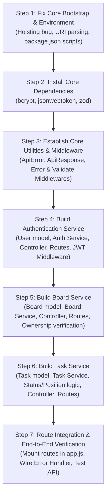

# DevFlow Backend — Project Architecture Audit & Technical Report

**Document Status:** Complete Architecture & Codebase Inspection  
**Target Project:** DevFlow (Trello-inspired Project Management Platform)  
**Stack Detected:** Node.js, Express.js, MongoDB / Mongoose, React (Frontend)  
**Audit Date:** October 2026  
**Auditor Role:** Senior Backend Developer & Software Architect  

---

## 1. Project Overview

### 1.1 Project Identity
- **Project Name:** DevFlow
- **Repository Layout:** Multi-project repository with decoupled subdirectories: `backend/` and `frontend/`.
- **Purpose:** A lightweight, high-performance Trello-inspired project management platform enabling users to create and manage workspaces/boards, organize tasks across status columns (e.g., To-Do, In Progress, Done), reorder cards, and track workflows.

### 1.2 Technologies Detected
| Layer | Declared / Detected Technology | Version Installed |
| :--- | :--- | :--- |
| **Runtime** | Node.js (ES Module mode, `"type": "module"`) | Node v22.14.0 (NPM 11.6.0) |
| **Web Framework** | Express.js | `^5.3.0` (v5.3.0 resolved) |
| **ODM / Database** | Mongoose / MongoDB | `^9.11.4` (v9.11.4 resolved) |
| **Process Management** | Nodemon | `^3.1.14` (installed in `dependencies`) |
| **HTTP Middleware** | CORS (`cors`), Cookie Parser (`cookie-parser`) | `cors` ^2.8.6, `cookie-parser` ^1.4.7 |
| **Environment Config** | Dotenv (`dotenv`) | `^18.0.9` (v18.0.9 resolved) |
| **Frontend Framework** | React + Vite | React `^19.3.1`, Vite `^8.3.4` |
| **Authentication Tools**| JWT & Bcrypt | **None installed** (Missing) |
| **Validation Tools** | Schema validator (Zod / Joi / Express-validator) | **None installed** (Missing) |

### 1.3 Current Development Stage
The backend is in an **early scaffolding / skeleton stage** (Commit `cf93e2d`: *"Implement backend server setup with Express, MongoDB connection, and environment configuration"*).
- Basic server bootstrapping and MongoDB connection boilerplate exist.
- Standard Express middleware (`cors`, `express.json`, `express.urlencoded`, `express.static`, `cookie-parser`) is wired in `app.js`.
- **All business logic, database models, controllers, services, routes, middleware, and utility classes are completely unwritten.**
- The project folders for architectural layers exist on disk but are completely empty, and the `services` folder was omitted entirely from the directory structure.

### 1.4 Overall Backend Readiness
**Readiness Rating: 15% (Bootstrap / Initial Setup Only)**
- Infrastructure & Server Init: **Functional with notable bugs** (hoisting & URI bugs).
- Database Connection: **Implemented with syntax fragility**.
- Data Models & Schemas: **0% Implemented**.
- Business & Service Logic: **0% Implemented**.
- API Routing & Endpoints: **0% Implemented**.
- Authentication & Authorization: **0% Implemented**.
- Error Handling & Validation: **0% Implemented**.

---

## 2. Actual Project Structure

### 2.1 Workspace Directory Tree
The actual filesystem structure inspected on disk is detailed below:

```
DevFlow/
├── .git/                                # Git repository metadata
├── Readme.md                            # Single line: "Initial set up"
├── frontend/                            # React 19 + Vite frontend project
│   ├── .env                             # Empty (0 bytes)
│   ├── .gitignore                       # Standard Vite/React gitignore
│   ├── eslint.config.js
│   ├── index.html
│   ├── package.json
│   ├── package-lock.json
│   ├── public/
│   │   ├── favicon.svg
│   │   └── icons.svg
│   ├── src/
│   │   ├── App.css
│   │   ├── App.jsx
│   │   ├── index.css
│   │   ├── main.jsx
│   │   └── assets/
│   └── vite.config.js
└── backend/                             # Express backend application
    ├── .env                             # Environment variables (Keys: PORT, MONGO_DB_PASSWORD, MONGO_DB_URI)
    ├── .gitignore                       # Node gitignore template
    ├── package.json                     # Backend manifest
    ├── package-lock.json                # Lockfile
    ├── public/                          # Static assets directory
    │   └── temp/
    │       └── .gitkeep                 # Empty placeholder for temporary file uploads
    └── src/
        ├── app.js                       # Express app configuration & middleware
        ├── constants.js                 # Shared constants (DB_NAME = "devflow")
        ├── index.js                     # Application entry point & DB bootstrap
        ├── DB/                          # Database connection module (Casing: uppercase "DB")
        │   └── index.js                 # Mongoose connectDB function
        ├── controllers/                 # [EMPTY DIRECTORY - 0 files]
        ├── middlewares/                 # [EMPTY DIRECTORY - 0 files]
        ├── models/                      # [EMPTY DIRECTORY - 0 files]
        ├── routes/                      # [EMPTY DIRECTORY - 0 files]
        └── utils/                       # [EMPTY DIRECTORY - 0 files]
```

### 2.2 Existing vs. Missing Expected Files and Directories

| Layer / Component | Existing on Disk | Expected for Target Architecture | Status |
| :--- | :--- | :--- | :--- |
| **Root Git Config** | None | `.gitignore` at repository root | **Missing** |
| **Backend Services Dir**| None | `backend/src/services/` | **Missing entirely** |
| **Entry Point** | `src/index.js` | `src/index.js` | **Exists** |
| **App Configuration** | `src/app.js` | `src/app.js` | **Exists** |
| **Database Module** | `src/DB/index.js` | `src/db/index.js` (lowercase recommended) | **Exists** (Casing issue) |
| **Constants** | `src/constants.js` | `src/constants.js` | **Exists** |
| **Environment Template**| None | `backend/.env.example` | **Missing** |
| **Models** | `src/models/` (empty) | `user.model.js`, `board.model.js`, `task.model.js` | **Missing files** |
| **Controllers** | `src/controllers/` (empty) | `auth.controller.js`, `board.controller.js`, `task.controller.js` | **Missing files** |
| **Services** | None | `auth.service.js`, `board.service.js`, `task.service.js` | **Missing files** |
| **Routes** | `src/routes/` (empty) | `auth.routes.js`, `board.routes.js`, `task.routes.js`, `index.js` | **Missing files** |
| **Middlewares** | `src/middlewares/` (empty)| `auth.middleware.js`, `error.middleware.js`, `validate.middleware.js` | **Missing files** |
| **Utilities** | `src/utils/` (empty) | `ApiError.js`, `ApiResponse.js`, `asyncHandler.js` | **Missing files** |

---

## 3. Architecture Explanation

### 3.1 Intended Architecture
The intended design for DevFlow is an enterprise-grade, layered **Clean Architecture / N-Tier Architecture**:
$$\text{HTTP Request} \longrightarrow \text{Routes} \longrightarrow \text{Middlewares} \longrightarrow \text{Controllers} \longrightarrow \text{Services} \longrightarrow \text{Models} \longrightarrow \text{MongoDB}$$

Each layer has strict boundary responsibilities:
1. **Routes (`src/routes/`):** Define URL path endpoints and HTTP verbs. Attach specific route-level middleware (authentication checks, schema validation) and forward verified requests to controllers.
2. **Middleware (`src/middlewares/`):** Intercept requests for cross-cutting concerns: authenticate JWT tokens, verify RBAC/ownership permissions, validate input schema, and catch uncaught application errors centrally.
3. **Controllers (`src/controllers/`):** Act strictly as HTTP adapters. Extract payload parameters (`req.body`, `req.params`, `req.query`, `req.user`), call appropriate service methods, and return formatted responses via standard `ApiResponse` objects. Controllers must contain **no business logic and no direct database queries**.
4. **Services (`src/services/`):** Encapsulate all core business rules, entity validations, transaction management, task position recalculations, ownership verification, and password hashing calls. Completely decoupled from Express `req` and `res`.
5. **Models (`src/models/`):** Define Mongoose schemas, data types, indexes, pre/post hooks (e.g., bcrypt password hashing), and custom instance/static methods.
6. **Database (`src/DB/`):** Manage connection pooling, reconnection policies, and lifecycle events with MongoDB.

### 3.2 Observed Deviations from Intended Architecture

1. **Complete Omission of the Service Layer Directory:**
   The directory `backend/src/services` does not exist on disk. While `controllers/`, `models/`, `routes/`, `middlewares/`, and `utils/` were created as empty folders, `services/` was never created. Without this folder, developers are prone to merging business logic directly into controllers, violating the intended separation of concerns.
2. **Missing Centralized Error Handling Pipeline:**
   In Express, error handling requires custom error classes (e.g., `ApiError`) and a terminal 4-parameter middleware `(err, req, res, next)`. In `src/app.js`, no error handling middleware or 404 handler is registered.
3. **Directory Casing Inconsistency:**
   The folder is named `src/DB/` (uppercase), while all sibling folders are lowercase (`src/controllers/`, `src/models/`, etc.). On case-sensitive operating systems (Linux production servers, CI/CD runners, Docker containers), referencing `./db/index.js` vs `./DB/index.js` causes fatal module resolution failures.
4. **Decoupled Application Lifecycle:**
   `src/app.js` sets up Express middlewares without listening on a socket. `src/index.js` imports `app`, connects to the database, and calls `app.listen()`. This separation is good practice (enables Supertest integration testing), but it currently suffers from an ES module hoisting bug (detailed in Section 4).

---

## 4. File-by-File Analysis

### 4.1 `backend/package.json`
- **File Path:** `E:\GitHub-Repo\DevFlow\backend\package.json`
- **Current Purpose:** Declares backend project metadata, scripts, module system (`"type": "module"`), and dependencies.
- **Implementation Status:** Incomplete / Misconfigured.
- **Important Observations:**
  - `"main": "index.js"`: Incorrect. The actual entry file is located at `src/index.js`.
  - `"scripts"`:
    - `"dev": "nodemon src/index.js"` is present.
    - Missing `"start": "node src/index.js"` for production deployments.
    - `"test"` script is a failing placeholder.
  - `"dependencies"`:
    - `nodemon` is placed under `"dependencies"` rather than `"devDependencies"`.
    - `express` is version `^5.3.0` (Express v5). Express 5 has native asynchronous rejection handling, but changes certain routing and query parsing behaviors.
    - `mongoose` is version `^9.11.4` (Mongoose v9).
    - Missing essential libraries: `jsonwebtoken`, `bcrypt` or `bcryptjs`, and schema validation (`zod` or `joi`).
- **Dependencies on Other Files:** References `src/index.js` in scripts.

### 4.2 `backend/src/index.js`
- **File Path:** `E:\GitHub-Repo\DevFlow\backend\src\index.js`
- **Current Purpose:** Main runtime entry point. Loads environment variables, initiates database connection, and starts the HTTP server.
- **Implementation Status:** Broken due to ESM Hoisting.
- **Code Inspection:**
  ```javascript
  import dotenv from "dotenv"
  import { connectDB } from "./DB/index.js"
  import { app } from "./app.js"

  dotenv.config({ path: './.env' })

  const PORT = process.env.PORT

  connectDB()
  .then(() => {
      app.listen(PORT, () => {
          console.log("[SERVER] Server Successfully Running :: Port", PORT)
      })
  })
  .catch((err) => {
      console.log("[SERVER] Server Failed Running ::", err);
  })
  ```
- **Important Observations & Critical Flaws:**
  1. **ES Module Hoisting Issue:** In JavaScript ES modules, all `import` declarations are evaluated before any top-level executable code runs. When `import { app } from "./app.js"` executes, `app.js` evaluates immediately. Inside `app.js`, `process.env.DEV_URL` is read. Because `dotenv.config()` has **not yet executed**, `process.env.DEV_URL` is `undefined`.
  2. **Dead `.catch()` Handler:** In `connectDB()` (`src/DB/index.js`), connection errors are caught inside `connectDB`, logged, and `process.exit(1)` is called immediately. The promise returned by `connectDB()` never rejects, meaning the `.catch((err) => ...)` block in `index.js` is dead code.
  3. **No Port Fallback:** If `PORT` is not defined in `.env`, `app.listen(undefined)` will default to an arbitrary ephemeral OS port or fail depending on the Node environment. It should use `process.env.PORT || 8000`.
- **Dependencies on Other Files:** Imports `dotenv`, `./DB/index.js`, `./app.js`.

### 4.3 `backend/src/app.js`
- **File Path:** `E:\GitHub-Repo\DevFlow\backend\src\app.js`
- **Current Purpose:** Configures the Express application instance, middleware stack, and global settings.
- **Implementation Status:** Partially Configured / Non-functional CORS.
- **Code Inspection:**
  ```javascript
  import express, { urlencoded } from "express";
  import cors from "cors";
  import cookieParser from "cookie-parser";

  const app = express();

  const allowedOrigin = [
      process.env.DEV_URL
  ]

  app.use(
      cors({
          origin: allowedOrigin,
          credentials: true
      })
  )

  app.use(express.json({limit: "16kb"}));
  app.use(express.urlencoded({extended: true, limit: "16kb"}));
  app.use(express.static("public"));
  app.use(cookieParser());

  export { app };
  ```
- **Important Observations & Flaws:**
  1. **CORS Configured with `[undefined]`:** Because of the hoisting issue noted above, and because `DEV_URL` is not present in `.env`, `allowedOrigin` evaluates to `[undefined]`. The CORS middleware will reject incoming requests from the frontend client.
  2. **Unused Import:** Line 1 imports named `urlencoded` from `"express"`, but Line 19 calls `express.urlencoded(...)`. The named import is unused.
  3. **Relative Static Directory:** `app.use(express.static("public"))` uses a relative path dependent on the Node process current working directory (`process.cwd()`). If started from a different folder, it fails silently to locate the static folder.
  4. **Zero Route Mounts:** No routers are imported or mounted.
  5. **No Error Middleware:** Uncaught exceptions or thrown errors will default to Express's built-in HTML error page instead of a structured JSON response.
- **Dependencies on Other Files:** Imported by `src/index.js`.

### 4.4 `backend/src/DB/index.js`
- **File Path:** `E:\GitHub-Repo\DevFlow\backend\src\DB\index.js`
- **Current Purpose:** Establishes connection to MongoDB via Mongoose ODM.
- **Implementation Status:** Partially Implemented / Fragile URI String Construction.
- **Code Inspection:**
  ```javascript
  import mongoose from "mongoose";
  import { DB_NAME } from "../constants.js";

  export const connectDB = async () => {
      const client = `${process.env.MONGO_DB_URI}/${DB_NAME}`;
      try {
          const connectionInstance = await mongoose.connect(client);
          console.log("[DATABASE] MongoDB Connected Successfully :: Connected Host ::", connectionInstance.connections[0].host);
      } catch (error) {
          console.log("[DATABASE] MongoDB Connection Failed ::", error);
          process.exit(1);
      }
  }
  ```
- **Important Observations & Fragility:**
  1. **Malformed URI Risk (Trailing Slash & Query Params):**
     `const client = `${process.env.MONGO_DB_URI}/${DB_NAME}`;`
     If `MONGO_DB_URI` in `.env` ends with a `/`, the concatenated string contains a double slash `...//devflow`. If the connection string contains query parameters (standard in MongoDB Atlas: `...mongodb.net/?retryWrites=true&w=majority`), appending `/${DB_NAME}` creates a malformed URI: `.../?retryWrites=true&w=majority/devflow`.
     *Best Practice:* Pass `dbName` as an option: `mongoose.connect(process.env.MONGO_DB_URI, { dbName: DB_NAME })`.
  2. **Abrupt Process Termination:** Calling `process.exit(1)` inside a utility function prevents graceful shutdown, retry logic, or custom application cleanup.
  3. **Missing Lifecycle Listeners:** Lacks event listeners for `mongoose.connection.on("error")` and `mongoose.connection.on("disconnected")`.
- **Dependencies on Other Files:** Imports `mongoose`, `../constants.js`. Imported by `src/index.js`.

### 4.5 `backend/src/constants.js`
- **File Path:** `E:\GitHub-Repo\DevFlow\backend\src\constants.js`
- **Current Purpose:** Stores application-wide constants.
- **Code Inspection:**
  ```javascript
  export const DB_NAME = "devflow"
  ```
- **Implementation Status:** Complete for its current scope.
- **Dependencies on Other Files:** Imported by `src/DB/index.js`.

### 4.6 `backend/.env`
- **File Path:** `E:\GitHub-Repo\DevFlow\backend\.env`
- **Current Purpose:** Local environment configuration.
- **Variables Present:** `PORT`, `MONGO_DB_PASSWORD`, `MONGO_DB_URI`.
- **Important Observations:**
  - `DEV_URL` is referenced in `src/app.js` but is missing from `.env`.
  - `MONGO_DB_PASSWORD` is defined but unused (the password is already embedded within `MONGO_DB_URI`).
  - No JWT secrets or expiration settings exist.
  - No `.env.example` file exists in the repository.

### 4.7 `backend/.gitignore`
- **File Path:** `E:\GitHub-Repo\DevFlow\backend\.gitignore`
- **Current Purpose:** Excludes sensitive and generated files from git tracking.
- **Implementation Status:** Comprehensive standard Node.js gitignore template. Properly ignores `.env`, `node_modules/`, and logs.
- **Observation:** Applies only to the `backend/` directory; the root repository has no `.gitignore`.

### 4.8 `backend/public/temp/.gitkeep`
- **File Path:** `E:\GitHub-Repo\DevFlow\backend\public\temp\.gitkeep`
- **Current Purpose:** Preserves the empty temporary uploads directory in git version control.
- **Implementation Status:** Present and correct.

---

## 5. Dependency Audit

### 5.1 Installed Dependencies Breakdown
Inspected directly from `backend/package.json` and resolved in `backend/package-lock.json`:

| Dependency | Declared Version | Resolved Version | Classification | Used in Code? | Evaluation & Purpose |
| :--- | :--- | :--- | :--- | :--- | :--- |
| `express` | `^5.3.0` | `5.3.0` | Production | Yes (`app.js`) | Core HTTP server framework. Note: Express 5 is very modern; verify middleware compatibility. |
| `mongoose` | `^9.11.4` | `9.11.4` | Production | Yes (`DB/index.js`) | MongoDB ODM. Handles schema definitions, validations, and queries. |
| `dotenv` | `^18.0.9` | `18.0.9` | Production | Yes (`index.js`) | Loads environment variables from `.env` file into `process.env`. |
| `cors` | `^2.8.6` | `2.8.6` | Production | Yes (`app.js`) | Cross-Origin Resource Sharing middleware for frontend-backend communication. |
| `cookie-parser`| `^1.4.7` | `1.4.7` | Production | Yes (`app.js`) | Parses HTTP cookies, needed for JWT access/refresh token extraction. |
| `nodemon` | `^3.1.14` | `3.1.14` | **Misplaced** | Yes (`npm run dev`)| Development auto-reload tool. **Should be in `devDependencies`**, not `dependencies`. |

### 5.2 Missing Dependencies Required for Intended MVP
The following critical dependencies are declared in the project requirements but are **missing from `package.json`**:

1. **`jsonwebtoken` (JWT):**
   - *Requirement:* Generating, signing, and verifying JWT access tokens and refresh tokens.
   - *Current State:* Not installed.
2. **`bcrypt` or `bcryptjs`:**
   - *Requirement:* Hashing user passwords securely using salt rounds before persisting to MongoDB, and comparing passwords on login.
   - *Current State:* Not installed.
3. **Request Validation Library (`zod` or `joi`):**
   - *Requirement:* Validating incoming request bodies, params, and queries (user registration, board creation, task updates).
   - *Current State:* Not installed.
4. **Development Tools (`devDependencies`):**
   - No linter (ESLint) or code formatter (Prettier) is installed in `backend/`.

### 5.3 Scripts and Module Configuration
- `"type": "module"` is configured, enabling standard ECMAScript Modules (`import` / `export`).
- Scripts present:
  - `"dev": "nodemon src/index.js"`
  - `"test": "echo \"Error: no test specified\" && exit 1"`
- Missing standard scripts:
  - `"start": "node src/index.js"` (essential for production deployment/Docker/PaaS)
  - `"lint": "eslint ."`

---

## 6. Environment Configuration

### 6.1 Audit of Environment Variables
*(Strict Compliance Note: In accordance with security instructions, no secret values, passwords, or connection strings are printed. Only variable names and their architectural purposes are documented.)*

| Environment Variable Name | Referencing File | Present in `.env`? | Status / Evaluation |
| :--- | :--- | :--- | :--- |
| `PORT` | `src/index.js` (L11) | **Yes** | Active. Defines the TCP port for Express server. |
| `MONGO_DB_URI` | `src/DB/index.js` (L6) | **Yes** | Active. MongoDB connection URI string. |
| `MONGO_DB_PASSWORD` | None | **Yes** | **Unused/Redundant.** Credential already embedded in `MONGO_DB_URI`. |
| `DEV_URL` | `src/app.js` (L8) | **NO** | **Missing from `.env`.** Causes `allowedOrigin` to be `undefined`. |
| `NODE_ENV` | Not referenced | **NO** | **Missing.** Needed to distinguish development vs. production behaviors. |
| `ACCESS_TOKEN_SECRET` | Not referenced | **NO** | **Missing.** Required for signing JWT access tokens. |
| `ACCESS_TOKEN_EXPIRY` | Not referenced | **NO** | **Missing.** Required for access token TTL (e.g., `15m`). |
| `REFRESH_TOKEN_SECRET`| Not referenced | **NO** | **Missing.** Required for signing JWT refresh tokens. |
| `REFRESH_TOKEN_EXPIRY`| Not referenced | **NO** | **Missing.** Required for refresh token TTL (e.g., `7d`). |

### 6.2 Missing Environment Artifacts
- **Missing `backend/.env.example`:** There is no template file specifying the required environment variable keys for onboarding new developers or configuring deployment pipelines.

---

## 7. Service Implementation Status

The backend is intended to be divided into three primary business domains:
1. **Authentication Service**
2. **Board Service**
3. **Task Service**

### 7.1 Authentication Service Status
| Feature / Component | Status | Existing Implementation | Missing Requirements | Architectural Observations |
| :--- | :--- | :--- | :--- | :--- |
| **User Model** | **Missing** | None (`models/` empty) | User schema, username/email/password fields, avatars, refresh token storage. | Pre-save password hashing hook (`bcrypt`) and JWT generation methods (`generateAccessToken`, `generateRefreshToken`) must be defined on the schema. |
| **Password Hashing** | **Missing** | None | `bcrypt` dependency, hashing on save, password comparison method. | Must handle password modification checks (`isModified("password")`). |
| **Registration Logic**| **Missing** | None | Input validation, duplicate check, user record creation, sanitized response. | Registration controller and auth service layer must be written. |
| **Login Logic** | **Missing** | None | Credential verification, access/refresh token generation, secure cookie setting. | Login controller, auth service, and cookie serialization needed. |
| **Token Verification**| **Missing** | None | `auth.middleware.js` to verify Bearer token or cookie, decode JWT, and attach user to `req.user`. | JWT verification middleware is completely missing. |
| **Current User (`/me`)**| **Missing**| None | Protected route handler returning sanitized authenticated user profile. | Depends on auth middleware. |
| **Logout Logic** | **Missing** | None | Clear HTTP-only cookies, invalidate stored refresh token in database. | Controller and route needed. |

### 7.2 Board Service Status
| Feature / Component | Status | Existing Implementation | Missing Requirements | Architectural Observations |
| :--- | :--- | :--- | :--- | :--- |
| **Board Model** | **Missing** | None (`models/` empty) | Board schema, title, description, columns (or column definitions), owner (`ref: 'User'`), members/collaborators. | Indexes on `owner` field required for query performance. |
| **Create Board** | **Missing** | None | Controller, service, route, default column generation (To Do, In Progress, Done). | Must associate authenticated user (`req.user._id`) as owner. |
| **Fetch User Boards** | **Missing** | None | Query boards where `owner === req.user._id`. | Service method and controller needed. |
| **Fetch Board by ID** | **Missing** | None | Query board with ownership/membership authorization check, populate tasks/columns. | Must ensure users cannot view boards belonging to other users. |
| **Update Board** | **Missing** | None | Update title, description, background color, column definitions with ownership check. | Must verify board ownership before allowing mutation. |
| **Delete Board** | **Missing** | None | Delete board and cascade-delete all associated tasks. | Requires transactional cleanup or Mongoose cascade hook. |
| **Board Ownership Check**| **Missing**| None | Middleware or service check verifying `board.owner.equals(userId)`. | Critical authorization boundary. |

### 7.3 Task Service Status
| Feature / Component | Status | Existing Implementation | Missing Requirements | Architectural Observations |
| :--- | :--- | :--- | :--- | :--- |
| **Task Model** | **Missing** | None (`models/` empty) | Task schema: title, description, status/columnId, priority, dueDate, position/order, boardId (`ref: 'Board'`), assignedTo (`ref: 'User'`). | Compound indexes needed on `{ boardId: 1, status: 1, position: 1 }`. |
| **Create Task** | **Missing** | None | Validate board ownership/access, calculate next position index, save task. | Must ensure task belongs to a valid board owned by user. |
| **Fetch Tasks by Board**| **Missing**| None | Query all tasks matching `boardId`, sorted by `position: 1`. | Must verify board ownership before returning tasks. |
| **Fetch Task by ID** | **Missing** | None | Query task, verify parent board access. | Requires parent board authorization check. |
| **Update Task** | **Missing** | None | Update title, description, priority, dueDate, assignee. | Must verify board ownership. |
| **Update Task Status** | **Missing** | None | Move task between columns/statuses (e.g., from "To Do" to "In Progress"). | Must recalculate positions in source and destination columns. |
| **Update Task Position**| **Missing**| None | Reorder task within the same column or across columns (drag-and-drop support). | Requires position index rebalancing logic in `task.service.js`. |
| **Delete Task** | **Missing** | None | Remove task record and re-index remaining tasks in column. | Controller, service, and route needed. |

---

## 8. API Status

### 8.1 Currently Implemented API Endpoints
**Total Implemented Endpoints: 0**

There are **no active routes or endpoints** implemented in the backend application.
`src/app.js` contains no route handlers (`app.get`, `app.post`, etc.) and mounts no route modules via `app.use()`.
Any incoming HTTP request to the server currently results in a `404 Not Found` response generated by default Express middleware.

### 8.2 Expected MVP API Endpoints (Currently Missing)

The following endpoints represent the required contract for the DevFlow MVP and must be implemented:

#### Authentication Endpoints (`/api/v1/auth` or `/api/v1/users`)
| HTTP Method | Route | Controller | Auth Required | Expected Payload / Response |
| :--- | :--- | :--- | :--- | :--- |
| `POST` | `/api/v1/auth/register` | `auth.controller.js:registerUser` | No (Public) | Body: `username`, `email`, `password` $\rightarrow$ 201 Created (Sanitized User) |
| `POST` | `/api/v1/auth/login` | `auth.controller.js:loginUser` | No (Public) | Body: `email`/`username`, `password` $\rightarrow$ 200 OK + JWT Tokens |
| `POST` | `/api/v1/auth/logout` | `auth.controller.js:logoutUser` | Yes (`verifyJWT`) | Headers: Bearer token / Cookie $\rightarrow$ 200 OK (Tokens Cleared) |
| `GET` | `/api/v1/auth/me` | `auth.controller.js:getCurrentUser` | Yes (`verifyJWT`) | 200 OK (User Profile Data) |
| `POST` | `/api/v1/auth/refresh-token` | `auth.controller.js:refreshAccessToken` | No / Cookie | Body/Cookie: `refreshToken` $\rightarrow$ 200 OK + New Access Token |

#### Board Endpoints (`/api/v1/boards`)
| HTTP Method | Route | Controller | Auth Required | Expected Payload / Response |
| :--- | :--- | :--- | :--- | :--- |
| `POST` | `/api/v1/boards` | `board.controller.js:createBoard` | Yes (`verifyJWT`) | Body: `title`, `description` $\rightarrow$ 201 Created (Board Document) |
| `GET` | `/api/v1/boards` | `board.controller.js:getUserBoards` | Yes (`verifyJWT`) | Query: pagination $\rightarrow$ 200 OK (Array of User Boards) |
| `GET` | `/api/v1/boards/:boardId` | `board.controller.js:getBoardById` | Yes (`verifyJWT`) | Params: `boardId` $\rightarrow$ 200 OK (Board + Columns/Task Summary) |
| `PATCH` | `/api/v1/boards/:boardId` | `board.controller.js:updateBoard` | Yes (`verifyJWT`) | Body: `title`, `description` $\rightarrow$ 200 OK (Updated Board) |
| `DELETE` | `/api/v1/boards/:boardId` | `board.controller.js:deleteBoard` | Yes (`verifyJWT`) | Params: `boardId` $\rightarrow$ 200 OK (Deletion Confirmation) |

#### Task Endpoints (`/api/v1/tasks` or nested `/api/v1/boards/:boardId/tasks`)
| HTTP Method | Route | Controller | Auth Required | Expected Payload / Response |
| :--- | :--- | :--- | :--- | :--- |
| `POST` | `/api/v1/boards/:boardId/tasks` | `task.controller.js:createTask` | Yes (`verifyJWT`) | Body: `title`, `description`, `status`, `priority` $\rightarrow$ 201 Created |
| `GET` | `/api/v1/boards/:boardId/tasks` | `task.controller.js:getBoardTasks` | Yes (`verifyJWT`) | Params: `boardId` $\rightarrow$ 200 OK (Tasks grouped/sorted by position) |
| `GET` | `/api/v1/tasks/:taskId` | `task.controller.js:getTaskById` | Yes (`verifyJWT`) | Params: `taskId` $\rightarrow$ 200 OK (Task Document) |
| `PATCH` | `/api/v1/tasks/:taskId` | `task.controller.js:updateTask` | Yes (`verifyJWT`) | Body: `title`, `description`, `priority`, `dueDate` $\rightarrow$ 200 OK |
| `PATCH` | `/api/v1/tasks/:taskId/status` | `task.controller.js:updateTaskStatus`| Yes (`verifyJWT`) | Body: `status`, `newPosition` $\rightarrow$ 200 OK |
| `PATCH` | `/api/v1/tasks/:taskId/position`| `task.controller.js:updateTaskPosition`| Yes (`verifyJWT`)| Body: `position`, `status` $\rightarrow$ 200 OK |
| `DELETE` | `/api/v1/tasks/:taskId` | `task.controller.js:deleteTask` | Yes (`verifyJWT`) | Params: `taskId` $\rightarrow$ 200 OK (Deletion Confirmation) |

---

## 9. Security Review

### 9.1 Password Handling
- **Current State:** Completely unimplemented.
- **Evidence:** Neither `bcrypt` nor `bcryptjs` is installed in `backend/package.json`. No `User` model exists to declare password hashing hooks or comparison methods.
- **Risk:** If a developer creates user endpoints without adding `bcrypt`, passwords could be accidentally stored in plaintext.

### 9.2 JWT Authentication & Session Security
- **Current State:** Completely unimplemented.
- **Evidence:** `jsonwebtoken` is absent from dependencies. No JWT signing secrets (`ACCESS_TOKEN_SECRET`, `REFRESH_TOKEN_SECRET`) exist in `.env`.
- **Observations:** `cookie-parser` is installed and registered in `src/app.js`, which is appropriate for reading HTTP-only refresh tokens. However, without secure cookie flags (`httpOnly: true`, `secure: true`, `sameSite: "strict"`), cookies are vulnerable to XSS and CSRF when implemented.

### 9.3 Authorization and Resource Ownership
- **Current State:** Completely unimplemented.
- **Risk Analysis:**
  - In a multi-tenant project management app like DevFlow, **horizontal privilege escalation (Insecure Direct Object References - IDOR)** is a primary threat.
  - A user must only be able to view, edit, or delete boards they own (or collaborate on).
  - Tasks belong to boards. If task routes accept a `:taskId` parameter directly without checking whether `task.board.owner === req.user._id`, malicious users can modify tasks belonging to other users.
  - Currently, no authorization helpers or ownership verification middleware exist.

### 9.4 CORS Configuration & Environment Variable Exposure
- **Current State:** Vulnerable / Misconfigured.
- **Evidence:**
  In `src/app.js`:
  ```javascript
  const allowedOrigin = [ process.env.DEV_URL ]
  app.use(cors({ origin: allowedOrigin, credentials: true }))
  ```
  Because `DEV_URL` is omitted from `backend/.env` and ES module hoisting prevents `dotenv` from populating `process.env` prior to this evaluation, `allowedOrigin` evaluates to `[undefined]`. This blocks legitimate frontend requests with a CORS error.
- **Sensitive Credentials in Version Control:**
  `backend/.gitignore` properly ignores `.env`. However, the root directory of the repository (`e:\GitHub-Repo\DevFlow\`) lacks a `.gitignore`. If any credentials, logs, or `.env` files are accidentally placed in the root directory, Git will track them.

### 9.5 Request Validation
- **Current State:** Completely absent.
- **Evidence:** No schema validation engine (`zod`, `joi`, or `express-validator`) is present in `backend/package.json`.
- **Risk:** Without strict schema validation, routes will be exposed to mass assignment vulnerabilities, MongoDB NoSQL injection attacks (e.g., passing `{"$ne": null}` in login body), and unhandled runtime type errors.

---

## 10. Issues and Risks

Issues have been categorized based on severity, blast radius, and impact on system stability:

```
┌────────────────────────────────────────────────────────┐
│                   ISSUE SEVERITY                       │
├──────────────┬─────────────────────────────────────────┤
│ CRITICAL     │ 3 Architectural / Runtime Flaws         │
│ HIGH         │ 3 Missing Core Architectural Modules    │
│ MEDIUM       │ 4 Configuration & Tooling Issues        │
│ LOW          │ 3 Minor Code Smells & Cleanups          │
└──────────────┴─────────────────────────────────────────┘
```

### 10.1 Critical Issues
1. **ES Module Hoisting Bug Breaking Environment Loading & CORS:**
   - *Location:* `src/index.js` and `src/app.js`
   - *Cause:* `import { app } from "./app.js"` is hoisted before `dotenv.config()` executes. `process.env.DEV_URL` evaluates to `undefined`, breaking CORS headers permanently upon server start.
   - *Impact:* Complete failure of frontend-backend communication.
2. **Missing Essential Authentication & Security Dependencies:**
   - *Location:* `backend/package.json`
   - *Cause:* `bcrypt` (or `bcryptjs`) and `jsonwebtoken` are missing from dependencies.
   - *Impact:* Cannot implement user registration, password hashing, login, or JWT session verification without modifying package dependencies.
3. **Fragile MongoDB URI String Concatenation:**
   - *Location:* `src/DB/index.js` (Line 6)
   - *Cause:* `const client = `${process.env.MONGO_DB_URI}/${DB_NAME}`;`
   - *Impact:* Because `MONGO_DB_URI` in `.env` has a trailing slash, this produces `...//devflow` (double slash). Furthermore, if MongoDB Atlas connection strings contain query parameters (`?...`), string appending creates an invalid connection URI and causes startup crashes.

### 10.2 High Issues
4. **Missing Architectural Layer (`services/`):**
   - *Location:* `backend/src/`
   - *Cause:* The `services` folder was never created in `src/`.
   - *Impact:* Violates the intended `Routes → Middleware → Controllers → Services → Models` architecture. Increases the risk of developers writing monolithic controllers containing raw Mongoose queries and tangled business rules.
5. **No Centralized Error Handling Mechanism:**
   - *Location:* `src/app.js`, `src/utils/`, `src/middlewares/`
   - *Cause:* No `ApiError` class, no `ApiResponse` class, no global error-handling middleware `(err, req, res, next)`.
   - *Impact:* Any unhandled promise rejection or runtime exception will either trigger unformatted HTML error dumps from Express, leak stack traces to clients, or crash the server process.
6. **Complete Absence of MVP Business Logic and Data Models:**
   - *Location:* `src/models/`, `src/controllers/`, `src/routes/`
   - *Cause:* Folders are 100% empty.
   - *Impact:* The application is an empty shell with zero functioning API endpoints.

### 10.3 Medium Issues
7. **Directory Casing Inconsistency (`src/DB` vs `src/controllers`):**
   - *Location:* `backend/src/DB/`
   - *Cause:* `DB` is uppercase, while all other directories are lowercase.
   - *Impact:* Windows filesystems are case-insensitive, but Linux deployment environments (AWS, Render, Railway, Docker) are case-sensitive. Importing `./db/index.js` instead of `./DB/index.js` will pass locally on Windows but crash immediately in production.
8. **Nodemon Placed in Production `dependencies`:**
   - *Location:* `backend/package.json`
   - *Cause:* `nodemon` is listed under `"dependencies"` instead of `"devDependencies"`.
   - *Impact:* Increases production container/slug size and installs development file watchers in production environments.
9. **Missing Production `"start"` Script and Incorrect `"main"` Entry:**
   - *Location:* `backend/package.json`
   - *Cause:* `"main": "index.js"` (should be `"src/index.js"`), and only `"dev": "nodemon src/index.js"` exists.
   - *Impact:* Standard production hosting platforms (which run `npm start`) will fail to launch the service.
10. **Lack of Request Schema Validation:**
    - *Location:* `backend/package.json`
    - *Cause:* No validation library (`zod` or `joi`) installed.
    - *Impact:* Controller inputs cannot be systematically validated before execution.

### 10.4 Low Issues
11. **Unused Import in `src/app.js`:**
    - *Location:* `src/app.js` (Line 1)
    - *Cause:* `import express, { urlencoded } from "express";` imports `urlencoded` but line 19 uses `express.urlencoded()`.
    - *Impact:* Minor dead code / linting violation.
12. **Relative Path in Static File Middleware:**
    - *Location:* `src/app.js` (Line 20)
    - *Cause:* `app.use(express.static("public"))` relies on `process.cwd()`.
    - *Impact:* If node is launched from outside `backend/`, static assets fail to resolve.
13. **Missing Root Repository `.gitignore` and `.env.example`:**
    - *Location:* Root directory `DevFlow/` and `backend/`
    - *Cause:* No root `.gitignore`; no `.env.example` template.
    - *Impact:* Developer onboarding friction and accidental git tracking risks at root.

---

## 11. Missing Implementation

To reach a functional MVP according to the project specifications, the following tasks must be completed in order of priority:

### 11.1 Required for MVP (P0 - Critical Path)

1. **Environment & Bootstrap Fixes:**
   - Fix ESM hoisting issue so `dotenv` executes before `app.js` or use `import "dotenv/config";`.
   - Add `DEV_URL` (e.g., `http://localhost:5173`) to `backend/.env`.
   - Fix MongoDB URI connection string assembly using `{ dbName: DB_NAME }`.
   - Add fallback port: `const PORT = process.env.PORT || 8000`.
   - Update `package.json` with `"start": "node src/index.js"`.
2. **Install Required Core Dependencies:**
   - Install `jsonwebtoken` for token issuance and verification.
   - Install `bcrypt` (or `bcryptjs`) for password hashing.
   - Install schema validation library (`zod` recommended, matching frontend ecosystem).
   - Move `nodemon` to `devDependencies`.
3. **Core Utilities & Middlewares:**
   - Create `src/utils/ApiError.js` (standard error encapsulation).
   - Create `src/utils/ApiResponse.js` (standard response payload format).
   - Create `src/utils/asyncHandler.js` (clean async controller wrapper).
   - Create `src/middlewares/error.middleware.js` (centralized error catcher).
   - Create `src/middlewares/auth.middleware.js` (JWT verification and `req.user` injection).
   - Create `src/middlewares/validate.middleware.js` (request validation).
4. **Architectural Directory Creation:**
   - Create `backend/src/services/` directory.
   - Rename `backend/src/DB/` to `backend/src/db/` for consistency.
5. **Authentication Domain:**
   - Create `src/models/user.model.js` (Schema with `username`, `email`, `password`, `avatar`, `refreshToken`, bcrypt hooks, and JWT helper methods).
   - Create `src/services/auth.service.js` (business logic for register, login, refresh tokens, logout).
   - Create `src/controllers/auth.controller.js` (HTTP handling).
   - Create `src/routes/auth.routes.js` (route definitions).
6. **Board Domain:**
   - Create `src/models/board.model.js` (Schema with `title`, `description`, `owner`, `columns`).
   - Create `src/services/board.service.js` (CRUD, board ownership validation).
   - Create `src/controllers/board.controller.js`.
   - Create `src/routes/board.routes.js`.
7. **Task Domain:**
   - Create `src/models/task.model.js` (Schema with `title`, `description`, `status`, `priority`, `position`, `boardId`, `assignedTo`).
   - Create `src/services/task.service.js` (CRUD, status transitions, position reordering, board access verification).
   - Create `src/controllers/task.controller.js`.
   - Create `src/routes/task.routes.js`.
8. **App Router Integration:**
   - Mount routes in `src/app.js`: `/api/v1/auth`, `/api/v1/boards`, `/api/v1/tasks`.
   - Register the global error middleware at the bottom of `src/app.js`.

### 11.2 Recommended for Production Readiness (P1)
- Create `backend/.env.example` documenting all configuration keys.
- Create root `.gitignore` to protect the entire repository workspace.
- Implement rate limiting (`express-rate-limit`) on auth routes (`/register`, `/login`) to prevent brute force attacks.
- Add security headers via `helmet`.
- Add MongoDB disconnection and reconnection listeners in `src/db/index.js`.
- Add standard logging (e.g., `morgan` or `winston`).

### 11.3 Optional / Future Enhancements (P2)
- Board member collaboration / invitation system (multi-user boards).
- Task activity audit log / comments.
- Task attachment file uploads (utilizing `public/temp/` and cloud storage like Cloudinary or AWS S3).
- WebSocket / Socket.io integration for real-time board updates across multiple users.

---

## 12. Recommended Development Order

To build the DevFlow backend cleanly without technical debt, the following step-by-step implementation order is recommended:



### Phase 1: Core Foundation & Configuration (Immediate Next Step)
1. In `src/index.js`, replace procedural `dotenv.config(...)` with `import "dotenv/config";` at the first line so that environment variables are loaded prior to any sub-module imports.
2. In `src/DB/index.js`, pass `dbName: DB_NAME` in Mongoose connection options instead of fragile string concatenation.
3. In `backend/.env`, define `DEV_URL=http://localhost:5173`.
4. In `backend/package.json`, add `"start": "node src/index.js"`, fix `"main": "src/index.js"`, and move `nodemon` to `devDependencies`.
5. Install missing dependencies: `npm install bcrypt jsonwebtoken zod` and `npm install -D nodemon`.

### Phase 2: Foundational Utilities & Error Handling Pipeline
1. Create `src/services/` directory.
2. Rename `src/DB/` to `src/db/` for cross-platform naming consistency.
3. Create standard response and error handlers:
   - `src/utils/ApiError.js`
   - `src/utils/ApiResponse.js`
   - `src/utils/asyncHandler.js`
4. Create global error-handling middleware: `src/middlewares/error.middleware.js`.
5. Mount the error middleware in `src/app.js`.

### Phase 3: Authentication Domain
1. Build `src/models/user.model.js`:
   - Fields: `username`, `email`, `password`, `avatar`, `refreshToken`.
   - Pre-save hook: Hash password with `bcrypt.hash()`.
   - Methods: `isPasswordCorrect()`, `generateAccessToken()`, `generateRefreshToken()`.
2. Build `src/middlewares/auth.middleware.js`:
   - Extract JWT from `Authorization` header (`Bearer <token>`) or `req.cookies.accessToken`.
   - Verify token and attach user to `req.user`.
3. Build `src/services/auth.service.js`:
   - Methods: `registerUser()`, `loginUser()`, `refreshAccessToken()`, `logoutUser()`.
4. Build `src/controllers/auth.controller.js` and `src/routes/auth.routes.js`.
5. Mount auth routes in `src/app.js` at `/api/v1/auth`.

### Phase 4: Board Domain
1. Build `src/models/board.model.js`:
   - Fields: `title`, `description`, `owner` (`ref: 'User'`), `columns` (e.g., Array of `{ id, title, order }`).
2. Build `src/services/board.service.js`:
   - CRUD operations.
   - Enforce ownership validation (`board.owner.equals(userId)`).
3. Build `src/controllers/board.controller.js` and `src/routes/board.routes.js`.
4. Protect board routes with `verifyJWT`. Mount in `src/app.js` at `/api/v1/boards`.

### Phase 5: Task Domain
1. Build `src/models/task.model.js`:
   - Fields: `title`, `description`, `status`, `priority`, `position`, `boardId` (`ref: 'Board'`), `assignedTo` (`ref: 'User'`).
2. Build `src/services/task.service.js`:
   - CRUD operations.
   - Verify user ownership of the parent board before permitting task actions.
   - Task position reordering and column-move logic.
3. Build `src/controllers/task.controller.js` and `src/routes/task.routes.js`.
4. Mount task routes in `src/app.js` at `/api/v1/tasks` (or nested under boards).

---

## 13. Backend Readiness Summary

| Metric | Evaluation |
| :--- | :--- |
| **Completed Work** | - Express application scaffolded with basic middlewares (`cors`, `json`, `urlencoded`, `cookieParser`, `static`).<br/>- MongoDB connection boilerplate written with Mongoose.<br/>- Basic project structure established (`controllers`, `models`, `routes`, `middlewares`, `utils`).<br/>- Local `.env` and `.gitignore` created in `backend/`. |
| **Incomplete Work** | - Entire business service layer (`src/services/`) is missing.<br/>- Zero models exist (`User`, `Board`, `Task`).<br/>- Zero controllers exist.<br/>- Zero routes exist.<br/>- Zero middlewares implemented (`auth`, `error`, `validate`).<br/>- Zero utility classes implemented (`ApiError`, `ApiResponse`).<br/>- Authentication and authorization mechanisms unbuilt. |
| **Broken / Critical Defects** | - **ESM Hoisting:** `dotenv.config()` runs after `app.js` evaluation, leaving `DEV_URL` undefined and breaking CORS.<br/>- **Missing `DEV_URL`:** `.env` does not define `DEV_URL`.<br/>- **URI Parsing:** `src/DB/index.js` concatenates `MONGO_DB_URI` and `DB_NAME` via simple slash, producing invalid double-slash / query-string corruption.<br/>- **Missing Dependencies:** `bcrypt` and `jsonwebtoken` are missing from `package.json`. |
| **Next Implementation Task** | **Foundation Fixes:** Fix the ESM hoisting and MongoDB URI bugs, add `DEV_URL` to `.env`, install `bcrypt`, `jsonwebtoken`, and `zod`, and create `src/services/` and `src/utils/`. |

---

## 14. AI DEVELOPMENT HANDOFF

> [!IMPORTANT]
> This section is a self-contained briefing for any AI assistant continuing the development of DevFlow. It encapsulates all architectural realities, existing constraints, active defects, and the exact next technical steps.

### Project & Stack Summary
- **Project:** DevFlow — Trello-inspired project management system (MERN stack).
- **Backend Tech Stack:** Node.js v22 (ESM `"type": "module"`), Express v5.3.0, Mongoose v9.11.4, MongoDB Atlas.
- **Intended Architecture:** `Routes → Middleware → Controllers → Services → Models → MongoDB`.
- **Target Domains:** Authentication Service, Board Service, Task Service.

### Current Codebase Reality
1. **Directory Structure:**
   - `backend/src/` currently contains only: `app.js`, `constants.js`, `index.js`, and `DB/index.js`.
   - The folders `controllers/`, `middlewares/`, `models/`, `routes/`, and `utils/` are **completely empty**.
   - The directory `backend/src/services/` **does not exist** and must be created.
   - The directory `backend/src/DB/` is capitalized; should be normalized to `db/`.
2. **Runtime Code Defects:**
   - **Hoisting Bug:** `src/index.js` imports `src/app.js` before executing `dotenv.config()`. `process.env.DEV_URL` evaluates to `undefined`, breaking CORS in `src/app.js`. Use `import "dotenv/config";` as line 1 of `src/index.js`.
   - **Environment Variable Missing:** `DEV_URL` is referenced in `src/app.js` but missing from `backend/.env`.
   - **URI Concatenation Bug:** `src/DB/index.js` constructs the MongoDB connection string using `${process.env.MONGO_DB_URI}/${DB_NAME}`. Because `MONGO_DB_URI` has a trailing slash, this creates a double slash (`...//devflow`). Instead, use:
     ```javascript
     await mongoose.connect(process.env.MONGO_DB_URI, { dbName: DB_NAME });
     ```
3. **Missing Package Dependencies:**
   - `bcrypt` (or `bcryptjs`) is NOT installed.
   - `jsonwebtoken` is NOT installed.
   - Schema validation library (`zod`) is NOT installed.
   - `nodemon` is incorrectly located in `"dependencies"` instead of `"devDependencies"`.
   - `backend/package.json` lacks `"start": "node src/index.js"`, and `"main"` incorrectly points to `index.js`.

### Exact Next Implementation Steps for AI Developer
1. **Step 1 — Fix Bootstrap & Config:**
   - Update `src/index.js` to import `"dotenv/config"` at top.
   - Update `src/DB/index.js` to pass `dbName` as a connection option.
   - Add `DEV_URL=http://localhost:5173` to `backend/.env` and create `backend/.env.example`.
   - Update `package.json` (add `start` script, correct `main`, install `bcrypt`, `jsonwebtoken`, `zod`, move `nodemon` to devDependencies).
2. **Step 2 — Scaffold Architectural Infrastructure:**
   - Create folder `backend/src/services/`.
   - Implement `src/utils/ApiError.js`, `src/utils/ApiResponse.js`, and `src/utils/asyncHandler.js`.
   - Implement `src/middlewares/error.middleware.js` and mount it as the terminal middleware in `src/app.js`.
3. **Step 3 — Implement Authentication Domain:**
   - Create `src/models/user.model.js` with bcrypt hashing and JWT generation methods.
   - Create `src/middlewares/auth.middleware.js` to verify JWT and attach user to `req.user`.
   - Create `src/services/auth.service.js`, `src/controllers/auth.controller.js`, and `src/routes/auth.routes.js`.
   - Mount routes at `app.use("/api/v1/auth", authRouter)` in `src/app.js`.
4. **Step 4 — Implement Board Domain:**
   - Create `src/models/board.model.js`, `src/services/board.service.js`, `src/controllers/board.controller.js`, and `src/routes/board.routes.js`.
   - Implement board ownership checks (`board.owner.equals(req.user._id)`).
   - Mount routes at `app.use("/api/v1/boards", boardRouter)`.
5. **Step 5 — Implement Task Domain:**
   - Create `src/models/task.model.js`, `src/services/task.service.js`, `src/controllers/task.controller.js`, and `src/routes/task.routes.js`.
   - Implement column status movement, position ordering, and board ownership verification.
   - Mount routes at `app.use("/api/v1/tasks", taskRouter)`.
